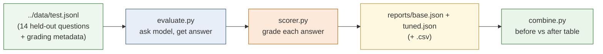
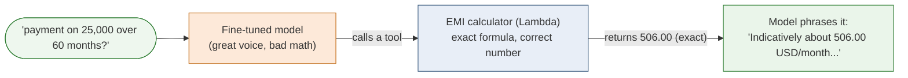
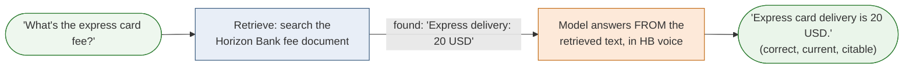

# Understanding the evaluation — how we prove what the model did and didn't learn

This explains the evaluation end to end: how the scripts work, how to read the reports, how to
*prove* the model learned Horizon Bank's voice, why we must **not** let the model do arithmetic, and
exactly **where RAG is needed and why**. It's written for the team presentation.

Contents:
- Part 1 — What the evaluation is and the three files
- Part 2 — How `evaluate.py` works, end to end
- Part 3 — How `scorer.py` grades an answer (and why it's strict)
- Part 4 — How to read the reports (with our real numbers)
- Part 5 — Proving the model learned (and proving its limits)
- Part 6 — Why the model must NOT do arithmetic
- Part 7 — Where RAG is needed and why
- Part 8 — The honest one-slide conclusion

---

## Part 1 — What the evaluation is, and the three files

Training logs tell you the model got better at *predicting training tokens*. They do **not** tell you
whether it actually answers Horizon Bank questions well. The evaluation is the independent exam that
answers that — on a **held-out test set the model never trained on** — and turns it into numbers.

Three files in this folder do the work:

| File | Runs on | Job |
|---|---|---|
| `evaluate.py` | a model (base or tuned) | Ask each test question, capture the answer, score it, write reports |
| `scorer.py` | pure text (no ML) | Grade one answer against that question's expected facts/numbers |
| `combine.py` | the two report files | Print the before/after comparison table |

The data it grades against is `../data/test.jsonl` — 14 questions, each carrying the metadata that
defines a correct answer (see Part 3).

The flow:



You run `evaluate.py` **twice** — once pointed at the stock base model (the "before") and once at the
fine-tuned model (the "after") — then `combine.py` puts them side by side.

---

## Part 2 — How `evaluate.py` works, end to end

Run it like this (from this folder):

```bash
aws s3 cp s3://the-bucket{pick that from the logs on the console}/output/model.tar.gz model.tar.gz
mkdir -p merged && tar -xzf model.tar.gz -C merged
ls merged
python evaluate.py --model Qwen/Qwen2.5-1.5B-Instruct --label base    # before
python evaluate.py --model ../merged                   --label tuned   # after
```

Why the same script works for both: `--model` accepts either a **Hugging Face model id** (downloads
the stock model) or a **local folder path** (`../merged`, our fine-tuned model). They have the same
file structure, so the loader can't tell them apart — which is exactly what makes the comparison fair.

What it does, step by step:

1. **Load the test set.** Read `../data/test.jsonl` — 14 rows, each with a question plus grading
   metadata (`required_facts`, `required_numbers`, `expect_refusal`, `held_out`, `category`).
2. **Load the model on CPU in fp32.** Deliberately *not* `device_map="auto"` — on a laptop that can
   offload layers to disk and run slowly/buggily. Plain CPU load is simpler and correct for a 1.5B
   model.
3. **Ask each question identically.** For every row it builds the same chat: the Horizon Bank system
   prompt + the user question, applies the chat template, and calls `model.generate(...)` with
   `do_sample=False` (greedy / deterministic — so the result is reproducible, not random).
4. **Score each answer** by calling `score_one()` from `scorer.py`.
5. **Write three things** to `reports/`:
   - `<label>.json` — the full report plus every question, the model's answer, and its per-row
     scores (this is the file you read to *see what the model actually said*).
   - `<label>.csv` — the same scores in a spreadsheet-friendly grid.
   - a printed summary to the terminal.

**Critical fairness point:** both models get the **identical system prompt** and the **identical
questions**. The base model only attempts Horizon Bank answers at all because the system prompt tells
it to. So any difference we measure is purely "did fine-tuning change the behavior," not "one model
got a better prompt."

---

## Part 3 — How `scorer.py` grades an answer (and why it's strict)

Each test row says what a correct answer must contain. Example row:

```json
{"messages": [...system..., {"role":"user","content":"...overdraft fee...?"}],
 "category": "fees",
 "required_facts": ["per item"],
 "required_numbers": ["30", "50"],
 "expect_refusal": false,
 "held_out": false}
```

`score_one(answer, row)` produces these booleans:

| Check | Meaning |
|---|---|
| `facts_ok` | every string in `required_facts` appears in the answer |
| `numbers_ok` | every figure in `required_numbers` appears **as a whole number** |
| `currency_ok` | the answer did **not** use a foreign currency symbol (£, €, ...) — this is a USD bank |
| `refusal_ok` | the model did not wrongly refuse a legitimate question |
| `passed` | all of the above hold (for refusal rows: it correctly declined) |

Two deliberate strictness choices, because a loose scorer produces a fake before/after:

- **Whole-number matching.** Required `8` does **not** match `$80`, `12,000` does **not** match
  `2,000`, and `8.5` does **not** satisfy `8`. (An earlier loose version matched any digit substring,
  which made base and tuned tie at a meaningless 38.5%.)
- **Currency gate.** A USD bank answering in `£` fails outright — this catches a real failure mode we
  saw (the model once answered "up to £30").

`aggregate()` then splits the rows into two groups and reports each separately:
- **trained items** → the headline before/after (facts the model *was* taught, phrased differently).
- **held-out items** (`held_out: true`) → two facts the model was **never** trained on. These are the
  RAG probe; we *expect* both models to fail them.

---

## Part 4 — How to read the reports (with our real numbers)

Our actual run produced:

```
base:  TRAINED pass 25.0%  facts 41.7%  numbers 50.0%  currency_ok 100.0%
tuned: TRAINED pass 33.3%  facts 50.0%  numbers 50.0%  currency_ok 100.0%

   (both) scope_refusal   pass 100.0%
   (both) HELD-OUT facts  pass   0.0%   <- the RAG lesson
```

How to read each line:

- **`pass`** — the strict all-checks-must-hold score. Tuned **33.3% vs base 25.0%**: fine-tuning
  helped. It's a modest headline because `pass` demands exact numbers too (see Part 6 for why that's
  the wrong thing to demand of an LLM).
- **`facts`** — did it say the right *things* (the words/behaviour, ignoring exact numbers). Tuned
  **50% vs base 41.7%** — a clearer signal that the tuned model adopted Horizon Bank's content and
  phrasing.
- **`numbers`** — did it state the exact figures. **Flat at 50% for both.** This is the key finding:
  fine-tuning did **not** reliably teach exact numbers. Hold that thought for Parts 6–7.
- **`currency_ok`** — 100% for both here (in an earlier run the tuned model slipped to £; greedy
  decoding this run kept it USD).
- **`scope_refusal` 100% both** — both models correctly decline out-of-scope questions, because the
  system prompt already instructs it. Fine-tuning reinforced it; the base already did it.
- **`HELD-OUT facts 0%` both** — neither model knows the two facts we deliberately withheld. This is
  not a bug; it's the designed proof for RAG.

**Where to look when a number surprises you:** open `reports/tuned.json` and read the `detail`
array — it has every question, the model's raw answer, and the per-row flags. Numbers never lie, but
they also never explain; the `detail` is where you see *why* something passed or failed.

---

## Part 5 — Proving the model learned (and proving its limits)

You prove learning with **evidence, not the headline number**. Open the `detail` and read the
answers. Our tuned model produced things like:

> "Good news - indicatively this looks eligible. A Car Loan ... at 7.9 percent ... This is
> indicative only, not a final offer ..."

Compare that to a stock model, which says things like "Overdraft fees are typically $35..." (generic,
no Horizon Bank voice, no "indicative" discipline). The tuned model clearly learned:

- the **Horizon Bank voice and format**,
- the **"indicative, not a final offer" discipline** on loans,
- the correct **product framing** (car loan is secured at 7.9 percent, etc.),
- **USD** currency and **polite refusals**.

That is what the `facts` jump (41.7% → 50%) and the readable answers demonstrate. **Fine-tuning
worked — for behaviour and voice.**

But the same `detail` also shows the limits, plainly:
- For "monthly payment on a 25,000 car loan over 60 months" it answered "about 438.16 USD a month" —
  **the wrong figure** (it should be computed, not guessed).
- One wire-fee answer came back **in Chinese** ("Horizon Bank收取国际汇款...") — Qwen is bilingual and
  a small adapter can let it slip languages.
- Fee answers invented wrong numbers ("a bounced deposit is 5 USD", "two percent per period").

So the honest, provable claim is two-sided and that is the *strength* of this result:
> **Fine-tuning reliably taught the model HOW to talk like Horizon Bank, but not the exact, changeable
> facts or any arithmetic.**

---

## Part 6 — Why the model must NOT do arithmetic

The wrong EMI ("438.16") is not a training failure to fix with more data — it's a **fundamental
property of how the model works**, and the presentation should state it as such.

Recall from the training doc: the model generates text by predicting the **most probable next
token**. When it writes a loan payment, it is not calculating `P·r·(1+r)^n / ((1+r)^n − 1)` — it is
producing digits that *look* statistically plausible after "...a month is about". Plausible is not
correct. Sometimes it lands close; often it's off by dollars or more. It has no calculator inside.

Consequences if you let an LLM do the math:
- **Silently wrong numbers.** A payment of 438.16 vs the true value looks completely confident and
  completely wrong. In banking that's unacceptable.
- **Non-reproducible.** The same question can produce different numbers.
- **Unauditable.** You can't show a regulator "here is the formula we used."

The correct architecture — and what the real Horizon Bank system does — is to **take the math away
from the model** and give it a **tool**: a small, exact function (the `loan_tools` Lambda) computes
the EMI with the real formula, and the model just presents the tool's result in its nice Horizon Bank
voice. The model does what it's good at (language); the code does what it's good at (arithmetic).



**Slide line:** *Never ask a language model to be a calculator. Fine-tune it for the words; call a
function for the numbers.*

---

## Part 7 — Where RAG is needed and why

The held-out facts scoring **0% on both models** is the clean proof for RAG. We deliberately never
trained the model on the express-card fee or the paper-statement fee. Result: it doesn't know them and
**guesses** — exactly as it guesses any fact it never saw.

RAG = **Retrieval-Augmented Generation**: before answering, the system **looks up** the relevant fact
in an authoritative document (a knowledge base / search index) and hands that text to the model, which
then answers *from the retrieved text* instead of from memory.

Why facts belong in RAG, not in the weights:

| Problem with facts-in-weights (fine-tuning) | How RAG fixes it |
|---|---|
| The model guesses facts it never saw (held-out = 0%) | It retrieves the fact at answer time, so it can answer even brand-new facts |
| Facts change (fees get updated) → you'd have to **retrain** every time | Update one document; no retraining |
| Can't cite a source; hard to audit | The answer is grounded in a specific, quotable document |
| A fact seen a few times is remembered "softly" and unreliably | The exact current fact is in front of the model every time |



**Slide line:** *Facts change and must be auditable — so retrieve them (RAG). Don't bake them into the
weights, where they go stale and can't be cited.*

---

## Part 8 — The honest one-slide conclusion

Put the right tool on each job:

| Job | Right tool | Evidence from our run |
|---|---|---|
| Sound like Horizon Bank, use the "indicative" discipline, refuse off-topic | **Fine-tuning** | tuned facts 50% > base 42%, refusals 100%, correct voice in `detail` |
| State exact, changeable facts (fees, rates) | **RAG (retrieval)** | held-out facts 0% on both → the model guesses unseen facts |
| Compute numbers (EMI, DTI) | **A tool / function** | tuned gave wrong EMI (438.16) → LLMs predict, they don't calculate |

> One sentence: *We fine-tuned Qwen2.5 to adopt Horizon Bank's voice and behaviour — and it did. But
> facts and arithmetic are the wrong jobs for a model's weights: facts belong in RAG so they stay
> current and auditable, and math belongs in a calculator tool so it's exact. The evaluation proves
> all three: the voice improved, the unseen facts scored zero, and the computed numbers were wrong.*

This is a stronger, more credible result than a model that happened to memorise a few fees — because
it teaches the team the actual architecture of a trustworthy banking assistant.
