# Understanding `train.py`

This explains what the QLoRA training script does, **every parameter it passes**, and **how to read
the training logs**. It's written so you can present the fine-tuning process confidently.

Structure:
- **Part 0 — The questions everyone asks first:** what happens to the model's existing knowledge, and
  does fine-tuning make the model bigger?
- **Part 1 — The big picture:** what the script is and where it runs.
- **Part 2 — The core concepts:** quantization, LoRA, QLoRA (plain language).
- **Part 3 — Every parameter, explained:** grouped by the function that receives it.
- **Part 4 — Reading the logs:** what each number means, using our real run.
- **Part 5 — The three decisions that made training actually work.**

### Q5. What IS a parameter, how does it hold information, and how does it combine with layers?

**What a parameter looks like.** A parameter is just **one number** — a weight such as `0.0427` or
`-1.83`. Nothing more. In fp16 it's stored in 16 bits; in 4-bit NF4 it's squeezed into 4 bits (one of
only 16 allowed values). The "intelligence" is never in a single number — it's in how billions of
them are arranged and what values they hold *together*.

**How numbers become knowledge.** Parameters live in **matrices** — grids of numbers. One layer's
weight `W` might be a 1536 × 1536 grid (~2.3 million numbers), and the model has hundreds of such
grids. A weight matrix is really a **transformation**: it takes the model's current internal vector
(its representation of the text so far) and multiplies it to produce a new vector that amplifies some
features and dampens others. The specific values in the grid *are* the learned rule — "when the input
looks like X, push the output toward Y." Knowledge is spread across millions of these tiny
multiply-and-add relationships, not stored as readable facts.

> Slide line: *A parameter is a dial. The model is billions of dials. "Knowledge" is the exact
> setting of all the dials together. Fine-tuning turns a tiny subset of dials (the adapter) a little.*

**If a parameter is "a number," what number is it — and are tokens numbers too?**
Yes, both are numbers, but **two different kinds**, and keeping them apart is the key insight:

| | What it is | Example | Changes during training? |
|---|---|---|---|
| **Parameter (weight)** | A *learned* value inside the model | `0.0427`, `-1.83` | Yes (well, the adapter's do) |
| **Token id** | A *lookup index* into the vocabulary | "love" -> `7045` | No — it's just a dictionary entry |

A token id carries **no meaning by itself** — it's only an address, like a word's page number in a
dictionary. The bridge from that address to actual numbers the math can use is the **embedding
table**: a big grid where each token id looks up a **vector** (a list of numbers, e.g. 1536 of them).
*Those* vector numbers are what flow through the layers and get multiplied by the parameters.

**Worked example — "I love the color ___".** Here's the whole journey from words to the next word:

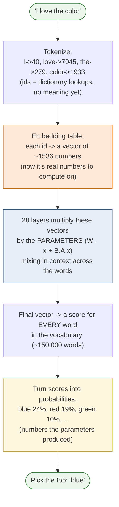

Step by step:
1. **Words -> token ids.** "I love the color" becomes integers like `[40, 7045, 279, 1933]`. These
   are just lookup indices — no meaning yet.
2. **Ids -> vectors (embeddings).** Each id is looked up in the embedding table and becomes a vector
   of ~1536 numbers. Now we have real numbers to do math on.
3. **Layers transform the vectors.** Each of the 28 layers multiplies these vectors by its
   **parameters** (`W·x`, plus the LoRA `B·A·x`), blending in the context of the surrounding words.
   This is where the model's "understanding" happens — purely as multiply-and-add with the learned
   weights.
4. **Produce a score for every possible next word.** The final vector is turned into a score for each
   of the ~150,000 words in the vocabulary.
5. **Scores -> probabilities -> pick.** Those scores become probabilities (e.g. blue 24%, red 19%,
   green 10%), and the model picks the most likely — "blue." Then it appends "blue" and repeats to
   generate the next word, and the next.

The punchline for students: **the parameters are the only thing that decides those final
probabilities.** Fine-tuning nudged a small set of them (via the adapter) so that for a Horizon Bank
question, the high-probability next words become Horizon Bank's actual policy wording instead of a
generic guess.

### Q7. If I ask "write Python code to check if a number is prime," how can it write that?

This surprises people, so it's worth stating plainly: **the model is not "coding." It is doing the
exact same next-word prediction as "I love the color ___" — code is just another kind of text.**

During pretraining the model read **millions of examples of real code** (GitHub, docs, tutorials). It
learned the statistical *shape* of correct Python so thoroughly that, token by token, the most likely
continuation of a prompt like "a function to check if a number is prime" *is* working code:

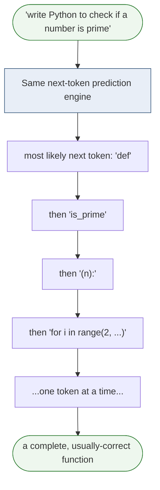

Crucial points for the slide:
- **It does not run the code.** It never executes anything. It *predicts* what correct code looks
  like, the same way it predicts "blue."
- **It has no concept of "prime" as a definition.** It has seen the *pattern* "prime check" paired
  with this kind of code so often that reproducing the pattern yields a correct answer.
- **This is why it can also be subtly wrong.** For a common task (prime check) the pattern is rock
  solid. For a rare or tricky task, the "most likely looking" code can contain a bug that *looks*
  right — because plausibility, not correctness, is what the model optimizes.

So "writing code" and "answering a banking question" are the **same mechanism**: continue the text
with the most probable tokens. Our fine-tune simply shifted those probabilities for one domain.

### Q8. What happens when the model doesn't know something (e.g. a fictional character)?

This is the most important honesty point in the whole talk. A raw language model has **exactly one
instinct: predict the most likely next words.** It does **not** have a built-in sense of "I don't
know." So when you ask about something it never saw — an obscure or fictional character — its default
behavior is to **make something up that sounds plausible**. That is a **hallucination**: fluent,
confident, and possibly wrong.

The three behaviors you listed are not equal — only one is the model's natural default:

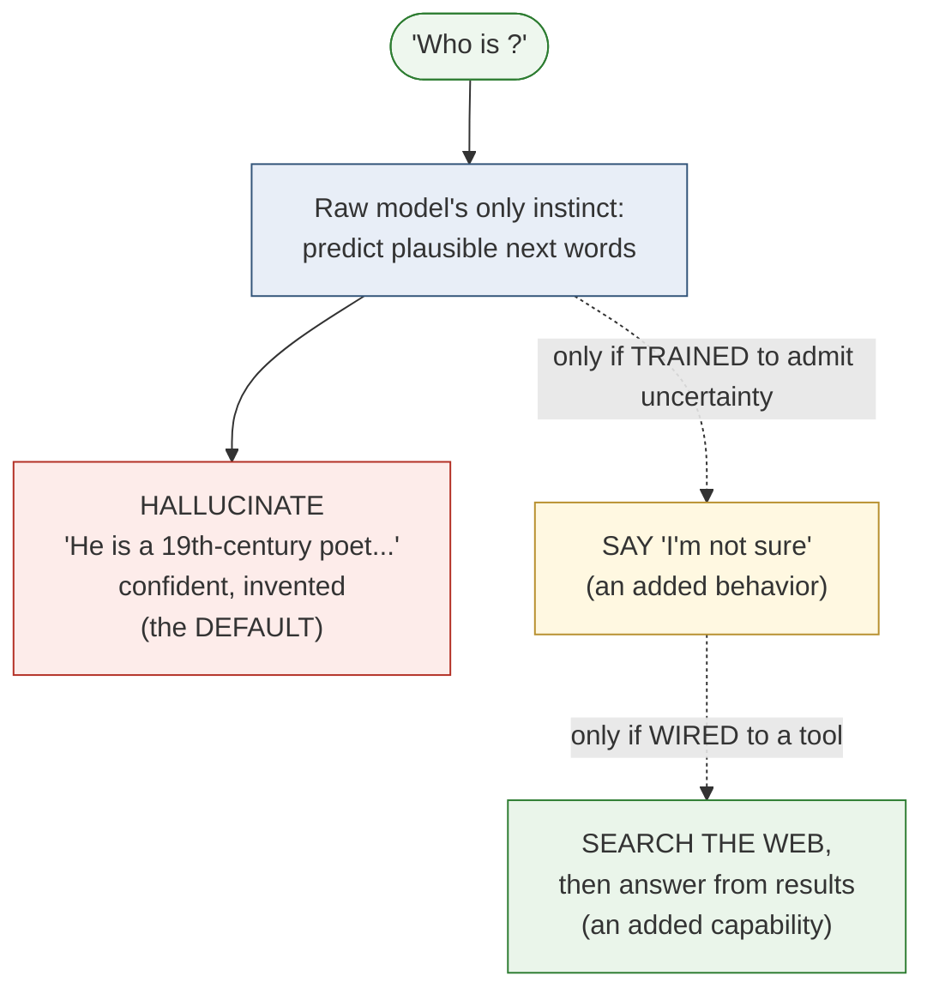

- **Hallucinate (the default).** With no extra training or tools, the model fills the gap with
  plausible-sounding text. It isn't "lying" — it has no mechanism to know it's wrong; it's just
  continuing the most likely pattern.
- **Say "I don't know" (must be trained in).** Admitting uncertainty is a *learned behavior*. Model
  makers add it by training on examples where the correct response is to decline. It reduces, but
  never fully eliminates, hallucination.
- **Search the web (must be wired in).** The model itself cannot browse. "Search then answer" is an
  external **tool** the surrounding application gives it (retrieval / web search / RAG). The model
  decides to call the tool, reads the returned text, and answers from *that* — grounding its answer in
  real data instead of guessing.

**Why this matters for our lab.** This is exactly the behavior we deliberately *taught* in the
dataset. Our training examples include refusals — e.g. "Can you read my balance?" -> "I can't see
your account details; check the app." and off-topic questions redirected politely. We trained the
model toward the safe behaviors (decline / redirect) instead of its natural instinct to invent an
answer. Our evaluation then **measures** this with the `scope_refusal` category: did the tuned model
correctly decline the out-of-scope questions rather than hallucinate? That is a direct, testable line
from this concept to a number in the report.

### Q9. How does a token actually change a parameter? (How the model learns)

This is the capstone concept. Take it slowly — it's the single most important idea in the whole talk,
and once it clicks, everything else (loss, grad_norm, learning rate, epochs) stops being jargon.

#### The framing to get right first

A token does **not** turn into a parameter. They are different kinds of things and they stay separate:

- A **token** is an input — a piece of the text, represented as an index, that we feed in.
- A **parameter** is a learned dial *inside* the model.

What actually happens is that the training tokens act as a **teacher**: they tell the model what the
right answer was, and that feedback is used to **turn the dials**. The tokens are never stored; only
their *influence* on the dial settings remains. Learning = adjusting dials so that, next time, the
model's guesses line up better with what the teacher showed.

#### First, three questions people always have (and should)

Before the loop, answer the "where does this all begin" questions — they're the ones that make the
rest finally make sense.

**(a) Who or what compels the model to predict the next token?**
Nothing mystical — **the model is physically built to do only one thing: output a probability for
every possible next token.** Its very last layer is a list of ~150,000 scores, one per vocabulary
word, every single time it runs. It cannot *not* produce that list; that's the shape of the machine.

So "prediction" isn't a decision the model chooses to make — it's the only output the architecture
has. What *compels it to get better* at predicting is the **loss function** we wrap around it during
training. We deliberately define the task as: "here is some text, predict the next token, and we will
score you on how much probability you gave the real next token." That scoring rule (the loss) is the
pressure. Backpropagation then pushes the dials to reduce that score. Remove the loss function and
the model still predicts — it just never improves. The loss is the "teacher's red pen."

**(b) Were the parameters empty before training? Where did they come from?**
They were **not empty** — they started as **small random numbers.** A brand-new, untrained network is
initialized with random values (tiny positive and negative numbers). At that moment the model is pure
noise: ask it anything and it outputs gibberish, because the dials are set randomly.

Training does **not fill empty slots**. Every dial already exists and already holds a value from the
very first step. Learning **reshapes** those random values into meaningful ones. Think of it as a
mixing board where every slider starts at a random position; training slides each one to where it
needs to be.

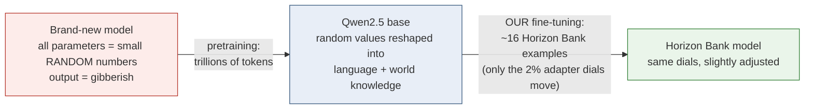

(Note: *we* didn't start from random — Alibaba already did the expensive "random -> knowledgeable"
pretraining to produce Qwen2.5. We started from their finished base and only nudged a thin adapter.
That's why our run cost cents instead of millions.)

**(c) How do the parameters get "locked inside" the network?**
They're never really "locked" — a parameter is just **a value sitting in a slot in memory.** Each
NUDGE in Stage 4 simply **overwrites** that slot with a slightly new value:

```
slot #123,456 holds 0.041700   ->  (nudge)  ->  now holds 0.041732
```

The dial doesn't move to a special "learned" place; its number is just updated in place, the way a
variable's value changes in a program. After the final training step we **save** all the current
values to a file (the `.safetensors` file). "Learned and locked in" literally means: *we stopped
nudging and wrote the current numbers to disk.* Load that file later and the model behaves exactly as
it did at the moment we saved — because it's the same numbers. There is no separate "memory" and no
magic; the knowledge **is** the saved list of numbers.

#### The one sentence the whole process reduces to

> The model makes a guess, we measure how wrong it was, we figure out which direction to turn each
> dial to be a little less wrong, and we turn each dial a tiny bit. Repeat millions of times.

That repeating loop has four stages. Here they are, then we trace a real Horizon Bank example through
each one with actual numbers.

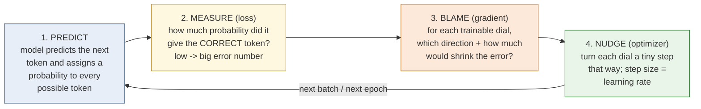

#### Tracing the Horizon Bank example — step by step with numbers

We train on the sentence: **"The overdraft fee is 30 USD per item."**

During training the model walks along this sentence and, at each position, tries to predict the
**next** token. Let's zoom in on the moment that matters: it has read **"The overdraft fee is"** and
must predict what comes next. The correct answer (from our data) is **"30"**.

**Stage 1 — PREDICT.** The model turns "The overdraft fee is" into vectors, pushes them through all 28
layers (each multiplying by its parameters), and produces a probability for *every* token in the
~150,000-word vocabulary. Early in training, a stock model has never seen Horizon Bank's number, so
its guess is generic:

```
Model's predicted next token (BEFORE learning this example):
   "about"  -> 22%
   "typically" -> 15%
   "25"     ->  8%
   "30"     ->  3%   <-- the CORRECT token, but only 3%
   ...everything else...
```

**Stage 2 — MEASURE (loss).** We look only at the probability it gave the **correct** token, "30".
It gave it just 3%. The loss is a number that is **high when that probability is low** and
**near zero when it's near 100%**. 3% is poor, so loss here is high. (Roll this up over every
position in every example in the batch and you get the single `loss` value in your logs — e.g. 2.81
at the start.)

> Intuition: loss answers one question — *"How much probability did you put on the right answer?"*
> The lower that probability, the more wrong you were, the higher the loss.

**Stage 3 — BLAME (gradient).** Now the clever part. The framework runs the math **backward** through
the network (this is "backpropagation") to answer, for **every trainable dial**: *"If I turned this
dial slightly up or slightly down, would the probability of '30' go up or down, and by how much?"*
The answer for each dial is its **gradient** — a direction (up/down) and a strength (how much it
matters). Dials that would help a lot get a big gradient; irrelevant dials get ~zero.

- The overall size of all these blame-signals combined is the **`grad_norm`** in your logs (ours was
  ~0.8–1.8). A healthy, non-zero grad_norm means "there is a clear way to improve."
- This is exactly why `grad_norm: 0.0` in the broken runs was fatal: it meant "no dial has any effect
  on the answer" — there was nothing to learn from, so nothing moved.

**Stage 4 — NUDGE (optimizer).** The optimizer takes each dial and moves it a **tiny** step in the
direction its gradient said. How big a step is set by the **learning rate** (`2e-4` = 0.0002 for us).
Concretely, one adapter dial might move like this:

```
dial value before:  0.041700
gradient says:       "increase this to make '30' more likely"
step (learning rate) 0.0002 scale
dial value after:    0.041732     <-- moved a hair
```

One dial moving by `0.000032` changes almost nothing on its own. But **every** relevant dial moves at
once, and we do this for every example, every epoch — thousands of nudges. Their combined effect is
that the probability of "30" after "The overdraft fee is" creeps upward.

**After many passes**, the same prediction looks completely different:

```
Model's predicted next token (AFTER learning):
   "30"     -> 71%   <-- now the top choice
   "about"  ->  6%
   "25"     ->  4%
   ...
```

The model now *reliably* produces Horizon Bank's real number — not because we stored the sentence,
but because the dials were nudged until "30" became the most probable continuation.

#### This is literally what your logs show

Every stage above maps to a column you watched scroll by:

| Stage | Log field | Our run, start -> end |
|---|---|---|
| 2. MEASURE | `loss` (train) | 2.81 -> 0.68 (guesses getting less wrong) |
| 2. MEASURE | `eval_loss` (held-out) | 2.60 -> 0.73 (generalizing, not memorizing) |
| 3. BLAME | `grad_norm` | ~1.6 at first, staying positive (a real signal every step) |
| 4. NUDGE | `learning_rate` | warms up then decays toward 0 (smaller nudges as it settles) |
| result | `mean_token_accuracy` | 0.41 -> 0.81 (right next-token far more often) |

So the falling loss curve in your logs is not an abstraction — it is the running score of this
guess / measure / blame / nudge loop getting better at predicting Horizon Bank's exact wording.

#### Where do the tokens "go"? (the closing point)

Nowhere — they are never stored inside the model. Each training token's only job is to be the
**correct answer** in Stage 2, so Stages 3–4 know which way to turn the dials. Once training ends, the
tokens are discarded; what survives is their *influence*, baked into the new dial settings. In our
QLoRA run only the ~2% adapter dials were turned — so the entire influence of the Horizon Bank
dataset lives in that small adapter, and the frozen base is untouched.

**How a parameter combines with the layers.** A "layer" is a step that applies its weight matrix to
the running representation, then hands the result to the next layer:

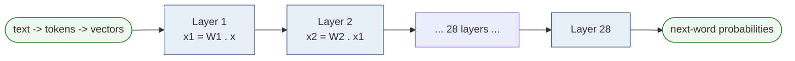

The parameters (the values inside each `W`) are **used by multiplication** at every layer — they are
the knobs that reshape the signal as it flows through. LoRA adds one extra tiny step at the chosen
layers: `x_new = W·x + B·(A·x)`, where `W` is the frozen base and `B·A` is the small learned
adjustment that is simply **added** to the base output.

### Q6. What if we had NOT used QLoRA — i.e. tried to train the quantized weights directly?

First, a clarification worth stating in the talk: **in QLoRA we never train the quantized weights.**
The 4-bit base is **frozen**; we train small full-precision LoRA adapters. So this question is really
"what if we tried to train the base weights directly instead?" The answer shows *why* QLoRA exists.

**You essentially cannot train 4-bit weights directly.** Training works by making millions of *tiny*
nudges (a weight edging from 0.5172 to 0.5174). But a 4-bit weight can only be one of **16 possible
values** — a nudge that small rounds straight back to the same bucket, so the update is lost and the
weight is stuck. That's the core reason learning can't happen in 4-bit.

QLoRA's trick is to route all the learning into **separate full-precision adapters** that *can* hold
tiny updates. The frozen 4-bit base supplies the knowledge; the high-precision adapter does the
learning.

If you ignored this and tried to full-fine-tune in full precision instead (the non-QLoRA path),
here's what would be affected:

| What changes | Consequence |
|---|---|
| Train all weights, not 2% | Needs optimizer state for **every** parameter → several times the VRAM → a far bigger, more expensive GPU. The $5 budget is gone. |
| Base weights are edited directly | Risk of **catastrophic forgetting** — overwriting pretrained general knowledge. LoRA avoids this by freezing the base. |
| Many more trainable numbers | Slower steps, more ways for training to destabilize. |
| (If you literally tried it in 4-bit) | Gradients round away → the model barely learns — a cousin of the `grad_norm ≈ 0` dead-training we debugged. |

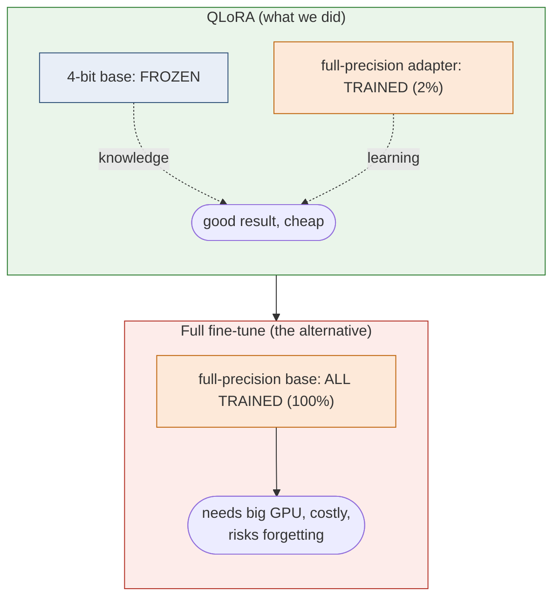

**Bottom line for the slide:** QLoRA exists precisely so we *don't* touch the quantized base. Freezing
it (not training it) is what keeps the lab cheap, fast, safe from catastrophic forgetting, and even
*possible* at all on a small GPU.

---

## Part 1 — The big picture

`train.py` is the "teacher." It loads a stock Qwen2.5-1.5B model, shows it our Horizon Bank
examples, and nudges a small set of added weights until the model answers like a Horizon Bank
assistant. It then saves the finished model.

```
train.jsonl + val.jsonl   +   Qwen2.5-1.5B (stock)   ->   train.py   ->   fine-tuned model
(our examples)                (the base model)             (teacher)       (saved to S3)
```

**Where it runs.** Not on a laptop. SageMaker starts a GPU machine (an `ml.g5.2xlarge`, one NVIDIA
A10G, 24 GB), runs this script there, then shuts the machine down. SageMaker tells the script where
things are through three environment variables:

| Variable | Meaning |
|---|---|
| `SM_CHANNEL_TRAIN` | folder containing `train.jsonl` |
| `SM_CHANNEL_VAL` | folder containing `val.jsonl` |
| `SM_MODEL_DIR` | folder to write the finished model into; SageMaker uploads it to S3 |

The flow of the script: **read those locations → load the model + data → train → merge → save.**

---

## Part 0 — The questions everyone asks first

Put this section first in the talk. These are the questions students and stakeholders always raise,
and getting them right builds trust in everything that follows.

### Q1. When the model is quantized to 4-bit, what happens to the knowledge it already has?

**Short answer: the knowledge is kept. Quantization compresses *how precisely* each weight is
stored, not *what the model knows*.**

Think of each weight as a number like `0.5172834…`. Quantization rounds it to a nearby value from a
small set of allowed 4-bit values — say `0.52`. Do that to every weight and you get a model that is
about one-quarter the size in memory, holding **almost exactly the same values**, just rounded.

A useful analogy for the slide: it's like re-saving a photo as a more compressed JPEG. It's still
clearly the same picture — you've lost a little fine detail, not the content. Qwen2.5 after 4-bit NF4
quantization still knows grammar, facts, reasoning, and how to hold a conversation. The quality drop
from good 4-bit quantization is small.

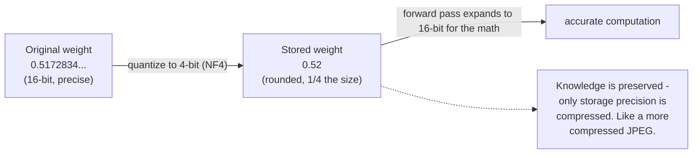

So quantization does **not** erase or reset the model's pretraining. It makes a faithful, compact
copy so it fits on a cheap GPU. That compact copy is then **frozen** — we don't change it during
training (see Q2).

Two honest nuances worth saying out loud:
- There *is* a small precision loss from rounding. For a support assistant it's negligible; for
  extremely precision-sensitive work you'd test it.
- During the forward pass the math is still done in 16-bit (`bnb_4bit_compute_dtype=bfloat16`) — the
  weights are *stored* in 4-bit and briefly expanded for the calculation. So the computation itself
  stays accurate.

### Q2. If the base is frozen, where does the new learning go? Does it overwrite the old knowledge?

**The old knowledge is never touched. New learning goes into separate, small add-on matrices (the
LoRA adapters).**

The mental model — adapters sit beside the frozen layers, and only they learn:

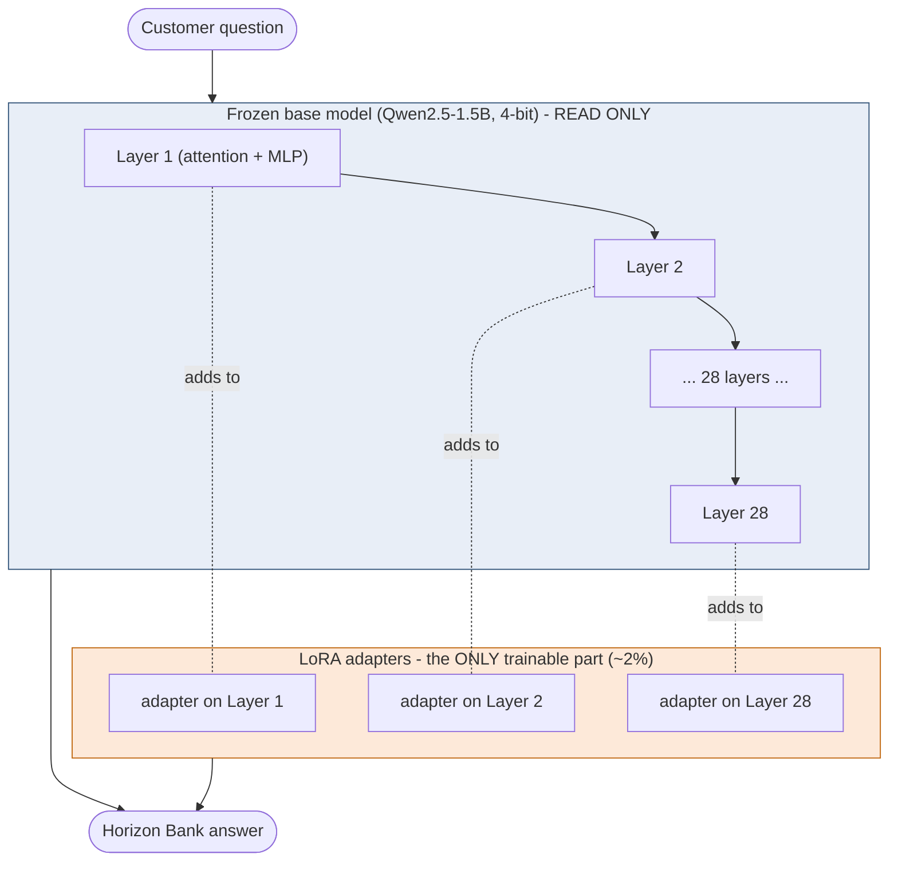

Zooming inside one layer, this is the actual LoRA math. The base weight `W` is frozen; the small
matrices `A` and `B` are the only things trained. The layer's output becomes `W·x + B·A·x`:

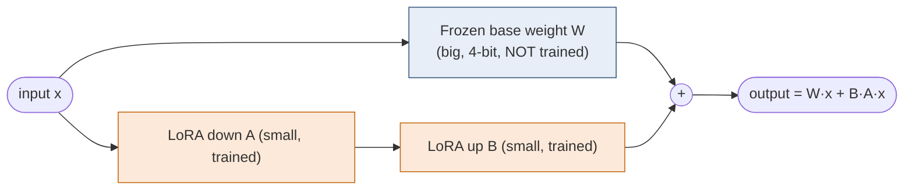

LoRA adds a thin pair of matrices next to certain layers. During training:
- The base weights are **frozen** — gradients never change them.
- Only the adapter matrices are updated.

So fine-tuning is **additive**, not destructive. We're not editing Qwen's brain; we're attaching a
small "Horizon Bank specialization" module that nudges the output. The general capabilities
(language, reasoning) remain, and the adapter biases answers toward Horizon Bank's policies.

> Caveat for the curious student: because the adapter shifts the output, very aggressive fine-tuning
> *can* make a model worse at unrelated tasks — this is called "catastrophic forgetting." LoRA
> greatly reduces that risk because the base is frozen and the adapter is small, but it isn't zero.
> Our run is light (a thin adapter, a small dataset), so the model stays a capable general assistant
> that is now also fluent in Horizon Bank specifics.

What this changes in practice — same question, before vs after:

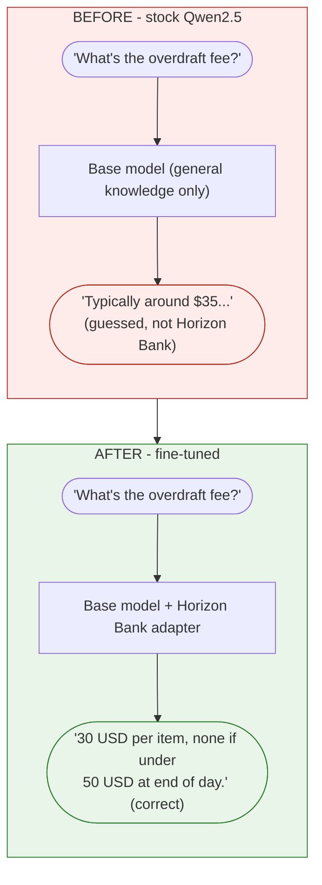

### Q3. Does fine-tuning increase the size of the base model?

**During training: almost not at all. After merging: no meaningful change — the result is the same
size as the original base model.**

The three states:

| State | What's stored | Illustrative size (1.5B model) |
|---|---|---|
| Base model | Original Qwen2.5-1.5B weights | ~3 GB in fp16 |
| During training | Base (frozen) **+** tiny LoRA adapters | Base + only ~18M extra params (~35 MB). The adapter is a rounding error next to the base. |
| After `merge_and_unload()` | Adapters folded into the weights → one ordinary model | ~3 GB — **essentially the same as the base** |

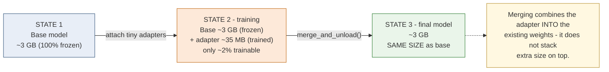

Key points for the team:
- The **trainable** part is ~2% of the parameters (our logs: `18,464,768 / 907,081,216`). That's how
  little we actually learn.
- If you keep the adapter *separate* (don't merge), you can ship just the ~35 MB adapter file and
  apply it on top of the base at load time — storage-efficient if you have many specializations.
- We **merge** here so the output is a single, normal model that needs no special loading. Merging
  mathematically combines the adapter into the existing weight matrices, so the parameter count — and
  therefore the file size — stays the same as the base. It does **not** stack the adapter's size on
  top.

**One-line answers for a Q&A slide:**
- *Does quantization lose the model's knowledge?* No — it compresses storage precision, like a
  higher-compression JPEG; the knowledge stays.
- *Does fine-tuning overwrite what the model knew?* No — the base is frozen; learning goes into a
  small separate adapter.
- *Does fine-tuning make the model bigger?* No — after merging, the fine-tuned model is the same size
  as the base.

### Q4. Deeper dive on quantization (the advanced questions)

These come up from sharper students. Answer them honestly — quantization is a *tradeoff*, not free.

**Is quantization only about loading the model into the GPU?**
No. Fitting in memory is the famous benefit, but there are three:
1. **Memory** — a 4-bit model uses ~1/4 the VRAM, so it loads on a smaller, cheaper GPU.
2. **Speed** — fewer bytes to move between GPU memory and compute cores. Since many models are
   limited by memory bandwidth, a quantized model can generate tokens *faster*.
3. **Cost / reach** — cheaper hardware, sometimes even a laptop or phone.

**Does a quantized model lose accuracy?**
Yes — a small, real, measurable amount. Be honest about this. A good 4-bit method typically loses a
few percentage points at most, sometimes near zero. The loss is **larger** when:
- the model is **small** (less redundancy to absorb rounding — a 1.5B feels it more than a 70B);
- the bit-width is **lower** (8-bit ≈ nearly lossless, 4-bit = small loss, 2-bit = often noticeable);
- the task is **precision-heavy** (exact arithmetic, long reasoning chains, code) rather than chat.
The quantization *method* matters too: NF4 (what we used), GPTQ, and AWQ are "smart" schemes built to
minimize this loss; naive rounding would be worse.

**Is the full (non-quantized) model better than the quantized one?**
On raw accuracy, slightly yes — full precision is the quality ceiling. On *practicality*, often no:
the quantized model wins on memory, speed, and cost. "Better" is a tradeoff, not an absolute. A
full-precision model that needs an expensive multi-GPU box is not "better" than a 4-bit version that
serves your users on one affordable GPU at ~1% lower accuracy — if that 1% doesn't matter for your
task. Rule of thumb: *full precision for maximum quality when you can afford it; quantized when
memory, speed, or cost are the real constraint — which is most of production.*

> Important for THIS lab: we only used 4-bit **during training** (to fit cheaply). At the end we
> merged the adapter and saved a **full-precision (fp16) model**. So our shipped model is NOT 4-bit —
> quantization was a temporary training-time memory trick, not a property of the final artifact.

**Why don't model creators just release a quantized model to begin with?**
- **Full precision is the master copy.** You quantize *from* it. Shipping only 4-bit would stop
  anyone making 8-bit, 3-bit, or a different scheme later. Full precision keeps every option open.
- **There is no single "the" quantized version** — 8-bit, 4-bit NF4, GPTQ, AWQ, GGUF variants each
  suit different hardware and tools. Creators can't pick one for everyone.
- **Quality depends on *how* you quantize** (GPTQ/AWQ use a calibration dataset; the best choice is
  often task-specific).
- **They often do release quantized versions — alongside the full one, not instead of it.**
- **Fine-tuning needs the full weights.** QLoRA 4-bit-loads a *full* checkpoint; you can't cleanly
  fine-tune a pre-quantized one the same way. Shipping full precision keeps the model trainable.

Analogy for a slide: the creator ships the **RAW photo**; quantized builds are **JPEGs at different
compression levels** exported for a target device. Keep the RAW because you can always make more
JPEGs from it — never the reverse.

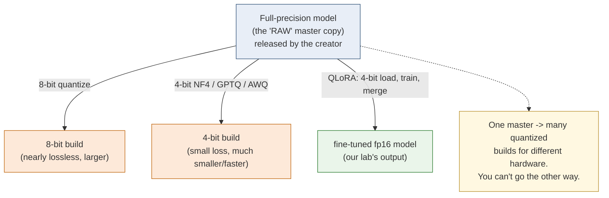

---

## Part 2 — The core concepts (for the slide)

**The model is weights.** A language model is billions of numbers ("weights"). Fine-tuning means
adjusting some of them so the model behaves the way we want on our data.

**Quantization — the "Q" in QLoRA.** Weights are normally stored as 16-bit numbers, which is memory
hungry. Quantization stores them in a compressed **4-bit** form (the format is called **NF4**). Same
model, roughly a quarter of the memory. This is what lets a 1.5B model train comfortably on one
modest GPU — and would let much larger models fit too.

**LoRA — the "LoRA" in QLoRA.** Instead of adjusting all billions of weights, LoRA **freezes** the
original model and adds a few small, trainable "adapter" matrices beside key layers. We train only
those adapters — about **2% of the parameters** in our run. Far cheaper, nearly the same result.
LoRA is one method in a family called **PEFT** (Parameter-Efficient Fine-Tuning).

**QLoRA = Q + LoRA.** Load the base model in 4-bit (frozen), train small LoRA adapters on top. That
combination is the whole reason this is cheap enough to do for a few dollars.

**Merge.** At the end we fold the trained adapters back into the base weights, producing one
ordinary model that needs no special loading later.

**One-line summary for the team:** *We froze a 4-bit copy of Qwen2.5 and trained a thin 2% "adapter"
layer on ~16 Horizon Bank examples, then merged it into a normal model.*

---

## Part 3 — Every parameter, explained

The script passes parameters to five things. Here is each one.

### 3.1 Command-line arguments (`args()`)

These are the knobs SageMaker (or you) can set from the launcher. Each has a default.

| Argument | Our value | What it controls |
|---|---|---|
| `--model-id` | `Qwen/Qwen2.5-1.5B-Instruct` | Which base model to fine-tune. |
| `--epochs` | `10` | How many times the model sees the whole training set. More passes = more learning (up to a point). |
| `--per-device-batch-size` | `2` | How many examples the GPU processes at once per step. Small = less memory. |
| `--grad-accum` | `4` | Gradient accumulation: pretend the batch is bigger by summing over 4 micro-batches before updating. Effective batch = 2 × 4 = **8**. |
| `--lr` | `2e-4` (0.0002) | Learning rate: how big each weight nudge is. Too high = unstable, too low = slow. 2e-4 is a standard LoRA value. |
| `--max-seq-len` | `1024` | Longest example (in tokens) the model will read; longer ones are truncated. |
| `--lora-r` | `16` | LoRA "rank" — the size of the adapter matrices. Bigger = more capacity, more params. |
| `--lora-alpha` | `16` | LoRA scaling factor — how strongly the adapters influence the model. |
| `--train-dir` / `--val-dir` | from `SM_CHANNEL_*` | Where the data files are (SageMaker sets these). |
| `--model-dir` | from `SM_MODEL_DIR` | Where to save the finished model (SageMaker sets this). |

### 3.2 Quantization recipe (`BitsAndBytesConfig`)

This tells the loader to compress the base model to 4-bit as it loads it.

| Parameter | Our value | Meaning |
|---|---|---|
| `load_in_4bit` | `True` | Turn on 4-bit quantization. This is the "Q." |
| `bnb_4bit_quant_type` | `"nf4"` | The 4-bit format. NF4 ("NormalFloat4") is tuned for how neural-net weights are distributed — the QLoRA paper's recommended type. |
| `bnb_4bit_use_double_quant` | `True` | Also quantize the quantization constants — squeezes out a little more memory for free. |
| `bnb_4bit_compute_dtype` | `torch.bfloat16` | Even though weights are stored in 4-bit, the actual math during a forward pass is done in bfloat16 (a 16-bit format) for accuracy. |

### 3.3 Loading the model (`AutoModelForCausalLM.from_pretrained`)

| Parameter | Our value | Meaning |
|---|---|---|
| `a.model_id` | Qwen2.5-1.5B | The model to download. |
| `quantization_config` | the `bnb` recipe above | Apply the 4-bit compression while loading. |
| `device_map` | `"auto"` | Place the model on the GPU automatically. |
| `dtype` | `torch.bfloat16` | Compute precision for non-quantized parts. |

Then two follow-ups:
- `prepare_model_for_kbit_training(model, use_gradient_checkpointing=False)` — small adjustments that
  make a 4-bit model trainable. We explicitly keep checkpointing **off** (see Part 5).
- `model.config.use_cache = False` — turns off the inference-time cache, which isn't used during
  training and would otherwise print a warning.

### 3.4 The LoRA adapter recipe (`LoraConfig`)

Describes the adapters. It is **handed to the trainer** (the trainer attaches them), not applied
here directly — this is the single most important fix in the whole script (Part 5).

| Parameter | Our value | Meaning |
|---|---|---|
| `r` | `16` | Rank — adapter size/capacity. |
| `lora_alpha` | `16` | Scaling — adapter influence. (A common rule of thumb is alpha ≈ r.) |
| `lora_dropout` | `0.0` | No dropout. Our dataset is tiny and clean, so we don't need this regulariser. |
| `bias` | `"none"` | Don't train bias terms — standard for LoRA. |
| `task_type` | `"CAUSAL_LM"` | Tells PEFT this is a text-generation model. |
| `target_modules` | the 7 projection layers | Which internal layers get adapters: the attention projections (`q_proj`, `k_proj`, `v_proj`, `o_proj`) and the feed-forward projections (`gate_proj`, `up_proj`, `down_proj`). These are Qwen2.5's standard LoRA targets. |

### 3.5 Training settings (`SFTConfig`)

| Parameter | Our value | Meaning |
|---|---|---|
| `per_device_train_batch_size` | `2` | Examples per step per GPU (see 3.1). |
| `gradient_accumulation_steps` | `4` | Effective batch = 8 (see 3.1). |
| `num_train_epochs` | `10` | Full passes over the data. |
| `learning_rate` | `2e-4` | Step size for weight updates. |
| `warmup_ratio` | `0.05` | Ramp the learning rate up over the first 5% of steps, then follow the schedule. Prevents an unstable start. |
| `logging_steps` | `1` | Print metrics **every** step — so we can see immediately whether it's learning. |
| `eval_strategy` | `"epoch"` | Run the validation set once per epoch. |
| `save_strategy` | `"no"` | Don't auto-save checkpoints; we save the final model ourselves. |
| `lr_scheduler_type` | `"cosine"` | Learning rate follows a smooth cosine curve down to ~0 by the end. |
| `optim` | `"adamw_torch"` | The optimiser (the algorithm that applies updates). Plain AdamW, to avoid edge cases in the 8-bit variant. |
| `bf16` | `True` | Train in bfloat16 precision. |
| `seed` | `42` | Fixes randomness so the run is reproducible. |
| `max_seq_length` | `1024` | Truncate examples longer than this. |
| `gradient_checkpointing` | `False` | Off on purpose (Part 5). |
| `report_to` | `"none"` | Don't send metrics to external logging services. |

### 3.6 The trainer (`SFTTrainer`)

| Parameter | What it is |
|---|---|
| `model` | The 4-bit base model from 3.3. |
| `processing_class` (or `tokenizer`) | The tokenizer. Newer TRL renamed this argument; the script tries the new name, falls back to the old. |
| `peft_config` | The `LoraConfig` from 3.4. **This is where LoRA actually gets attached.** |
| `train_dataset` / `eval_dataset` | The `messages` datasets. TRL applies the chat template itself. |
| `args` | The `SFTConfig` from 3.5. |

Before training we print `TRAINABLE PARAMS` — a one-line proof that the adapters are attached (should
be ~2%). If that ever read 0%, training would be pointless and we'd stop.

### 3.7 Saving (end of script)

- `trainer.model.save_pretrained("/tmp/adapters")` — save just the trained adapters.
- Reload the base model in fp16, `PeftModel.from_pretrained(...).merge_and_unload()` — **fold the
  adapters into the weights**, giving one ordinary model.
- `merged.save_pretrained(a.model_dir, safe_serialization=True)` — write it (as `.safetensors`) into
  `SM_MODEL_DIR`. SageMaker uploads that folder to S3 as `model.tar.gz`. That's how we get the model
  back.
- A small `training_metrics.json` (runtime, final loss) is written for the report.

---

## Part 4 — Reading the training logs

These are the actual numbers from our successful run. This is the part to walk the team through,
because it's the evidence the training worked.

### 4.1 The one-time startup lines

```
TRAINABLE PARAMS: 18,464,768 / 907,081,216 (2.0356%)
```
Only ~18M of ~907M parameters are trainable — **2%**. That's LoRA working: we're training a thin
adapter, not the whole model. (907M, not 1.5B, because the frozen base is counted in its packed
4-bit form.) Seeing a non-zero number here is the proof the adapters are attached.

### 4.2 A single training-step line, field by field

```
{'loss': 2.3471, 'grad_norm': 0.7863, 'learning_rate': 0.00019458,
 'entropy': 2.186, 'num_tokens': 7344, 'mean_token_accuracy': 0.482, 'epoch': 2.0}
```

| Field | Meaning | Healthy sign |
|---|---|---|
| `loss` | How wrong the model is on the training batch. The number being minimized. | **Decreasing** over steps. |
| `grad_norm` | Size of the gradient — the strength of the learning signal reaching the adapters. | **Non-zero** (ours ~0.8–1.8). `0.0` means nothing is learning. |
| `learning_rate` | Current step size (follows warmup then the cosine decay). | Rises during warmup, then falls toward 0. |
| `entropy` | How "unsure" the model is across its vocabulary. | Trends down as the model gets confident. |
| `num_tokens` | Running count of tokens seen. | Just climbs. |
| `mean_token_accuracy` | Fraction of next-tokens predicted correctly on the batch. | **Increasing** toward 1.0. |
| `epoch` | Progress through the 10 passes. | Goes 0 → 10. |

### 4.3 The trajectory of our real run — the headline evidence

| Epoch | `loss` (train) | `eval_loss` (held-out) | `mean_token_accuracy` | `grad_norm` |
|---|---|---|---|---|
| ~1 | 2.81 | 2.60 | 0.41 | 1.67 |
| 2 | 2.35 | 2.22 | 0.48 | 0.79 |
| 3 | 1.97 | 1.86 | 0.54 | 0.88 |
| 5 | 1.35 | 1.25 | 0.65 | 1.25 |
| 7 | 0.89 | 0.87 | 0.74 | 1.82 |
| 10 | 0.68 | 0.73 | 0.81 | 1.01 |

Read this out loud for the team:
- **Training loss fell 2.81 → 0.68.** The model learned the material.
- **Validation (eval) loss fell 2.60 → 0.73** — and it tracked the training loss down rather than
  rising, so the model generalized to held-out examples rather than just memorizing.
- **Token accuracy nearly doubled, 0.41 → 0.81.**
- **`grad_norm` stayed positive the whole time** — the learning signal was alive every step.

### 4.4 Why `eval_loss` is the honest metric

Training loss can drop just from memorizing. `eval_loss` is measured on the 4 validation examples the
model never trains on, so its fall is evidence of real learning. The final model-quality proof is the
separate before/after evaluation on the held-out **test** set — that's the next step.

### 4.5 The final summary line

```
{'train_runtime': 25.73, ... 'train_loss': 1.461, 'epoch': 10.0}
...
Training seconds: 371
Billable seconds: 371
```

- `train_runtime: 25.7s` — the GPU math took ~26 seconds (tiny dataset).
- `Billable seconds: 371` — total billed time including container start, model download, and the
  merge/save. At the `ml.g5.2xlarge` rate this run cost roughly **$0.20**.

### 4.6 What a BROKEN run looked like (worth one slide)

Earlier runs showed this, and it's instructive:
```
grad_norm: 0.0        # every step
loss: 2.92            # never moved
eval_loss: 2.9848861694335938   # identical to 16 digits, every epoch
```
`grad_norm: 0.0` with a perfectly frozen loss means **no learning signal reached the adapters** — the
model trained on nothing. Part 5 is why that happened and how we fixed it.

---

## Part 5 — The three decisions that made training work

These are the hard-won fixes. Each is worth a sentence in the presentation because each one, if
wrong, silently produces a model that learned nothing.

1. **LoRA is applied in exactly one place — the trainer, via `peft_config`.** We do NOT also call
   `get_peft_model` ourselves. Applying LoRA twice detached the adapters from the graph the trainer
   optimized; gradients had nowhere to flow (`grad_norm: 0.0`, then `element 0 of tensors does not
   require grad`). One owner of LoRA = gradients flow.

2. **Gradient checkpointing is OFF.** Checkpointing is a memory-saving trick that recomputes
   activations; on this 4-bit + LoRA stack it broke the gradient path. A 1.5B 4-bit model doesn't
   need it on a 24 GB GPU, so we simply removed it.

3. **The dataset is passed as raw chat `messages`.** We let TRL apply Qwen's chat template. We do NOT
   pre-flatten to a `"text"` string (that broke the loss masking so every token was ignored), and we
   do NOT use `assistant_only_loss` (Qwen2.5's chat template lacks the `` markers it
   requires).

The library stack in the container was transformers 4.56 / trl 0.23 / peft 0.17 / torch 2.8. These
three points are specific to how that recent stack handles 4-bit QLoRA.

---

## One-paragraph version for the opening slide

> We fine-tuned the open-source Qwen2.5-1.5B model on Amazon SageMaker using QLoRA: the base model
> was frozen and compressed to 4-bit, and we trained a small adapter (~2% of parameters) on a set of
> Horizon Bank support examples. On a single mid-range GPU the job finished in minutes and cost about
> twenty cents. Training loss fell from 2.8 to 0.7 and held-out validation loss from 2.6 to 0.7, with
> next-token accuracy rising from 41% to 81% — evidence the model genuinely learned Horizon Bank's
> policies, which we confirm with a separate before/after test.
